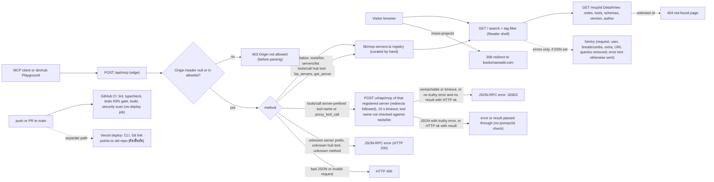
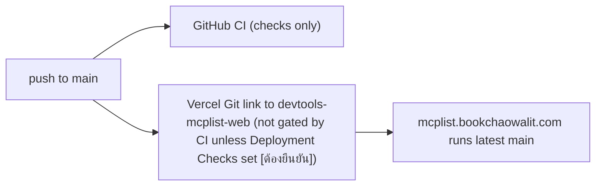

# 01 — Business process (As-Is / To-Be)

devtools-mcplist-web คือไดเรกทอรีของ MCP server ในพอร์ตโฟลิโอ (ทะเบียนที่คัดมือใน `lib/mcp-servers.ts`) พร้อมหน้ารายละเอียดต่อ server และ endpoint JSON-RPC (Edge) ที่ตอบจากทะเบียนเดียวกัน และส่งต่อ tool ของ server อื่นไปยัง `<url>/api/mcp` ที่ลงทะเบียนไว้เป็น URL เริ่มต้น (fetch ตาม redirect ของ upstream โดยไม่ตรวจปลายทางซ้ำ) ไม่มีการตรวจ uptime หรือยืนยันว่า tool ตรงกับที่ประกาศ

Last reviewed: 2026-11-28 · commit `fe64ab4`

## As-Is (จากโค้ดวันนี้)

Sources: `lib/mcp-servers.ts`, `lib/mcp-hub.ts`, `lib/cors.ts`, `app/api/mcp/route.ts`, `app/page.tsx`, `app/mcp/[id]/page.tsx`, `components/mcp-views.tsx`, `next.config.ts`, `lib/sentry.ts`, `.github/workflows/ci.yml`, `README.md`, `PRODUCT.md`

ข้อเท็จจริงสำคัญจากโค้ด:

- origin allowlist ค่าเริ่มต้น: เว็บนี้และ devhub (แทนที่ได้ด้วย `CORS_ALLOWED_ORIGINS`); คำขอที่ไม่มี Origin (MCP client ที่ไม่ใช่เบราว์เซอร์) ผ่านได้; CORS ไม่ได้เป็นระบบยืนยันตัวตน
- route เริ่มดึงจาก URL ที่ประกาศในทะเบียน แต่ `fetch` ตาม redirect ตามค่าเริ่มต้นและไม่ตรวจปลายทางซ้ำ จึงปลายทางหลัง redirect ไม่ถูกควบคุมโดยทะเบียน; route ตอบ JSON-RPC error ส่วนใหญ่ด้วย HTTP 200 (เฉพาะ parse error และ invalid request เป็น 400)
- hub ตรวจเฉพาะ prefix ชื่อ server (`resolveTool`) และ hub tool ที่ไม่รู้จัก; tool ของ server อื่นถูกส่งต่อแม้ไม่อยู่ใน `tools/list` ให้ upstream ตัดสิน และ tool ที่ลงทะเบียนไว้ไม่ถูกตรวจเทียบกับ server จริง
- proxy ไม่ตรวจ `jsonrpc`/`id` ของ upstream: รับ JSON ที่มี `error` truthy หรือ HTTP ok ที่มี `result`
- ไม่มี workflow deploy ใน repo; ตาม PRODUCT.md (2026-10-23) deploy ด้วย Vercel CLI และ Git link ชี้ repo เก่า [ต้องยืนยัน] สถานะวันนี้
- `NEXT_PUBLIC_SENTRY_DSN` บน production: [ต้องยืนยัน]; เมื่อเปิด Sentry `beforeSend` (`lib/sentry.ts`) ลบ request, user, breadcrumbs, extra, contexts นอก platform, ตัด query/hash และลบ frame vars แต่ไม่ได้กรองข้อมูลอื่นในข้อความ error

## To-Be (จาก PRODUCT.md §Live URL and deploy state)

Sources: `PRODUCT.md` (owner action D9)

## Gap

| ID | As-Is → To-Be | Status | Owner | Evidence |
|---|---|---|---|---|
| G1 | deploy ด้วย CLI และ Git link ชี้ repo เก่า (live ไม่มีการแก้ MCP route และ Sentry) → เชื่อม Vercel Git กับ `devtools-mcplist-web` | decide | owner | `PRODUCT.md` owner action D9 [ต้องยืนยัน] สถานะปัจจุบัน |
| G2 | ไม่มี uptime/health check ของ server ที่ลงทะเบียน → owner ตัดสินว่าต้องการหรือไม่ (ไม่มี To-Be เขียนไว้) | decide | owner | `PRODUCT.md` §What does not work |

## Open questions

- Vercel Git link ของโปรเจกต์ `bookchaowalit-mcplist-frontend` ยังชี้ repo เก่าอยู่หรือไม่
- `NEXT_PUBLIC_SENTRY_DSN` ตั้งบน production หรือไม่
